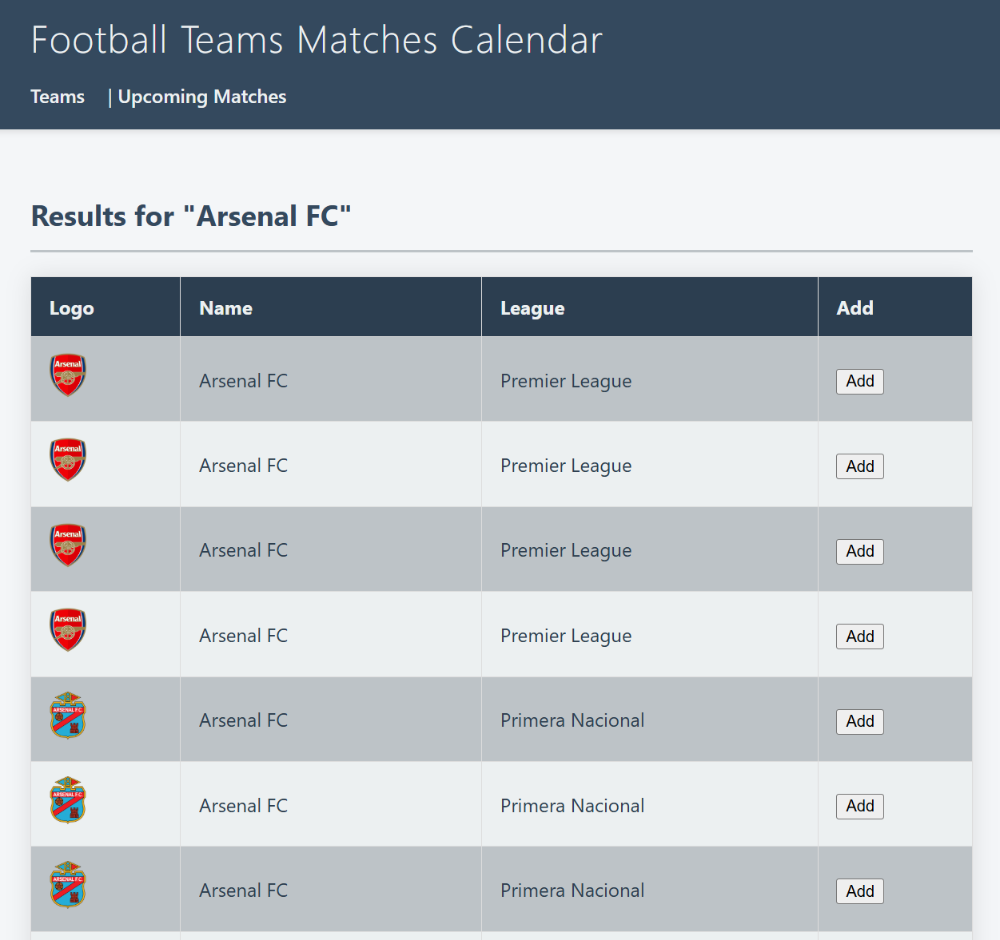
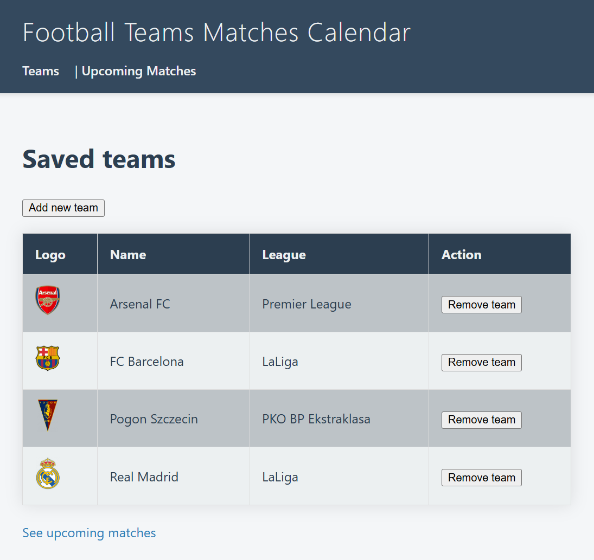
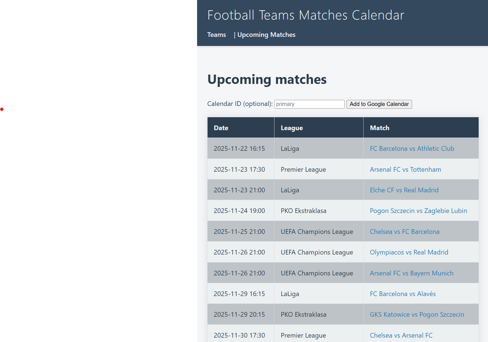

# Teams Matches Calendar
Simple Django app for collecting matches dates.
Initially it was databse-driven, but now I'm using cookie for storage, 
making it usable by anyone without user management.

- Find a team and add it to cookie storage
- Find upcoming matches of all added teams
- Add matches to a Google Calendar, using provided CalendarID or 'primary' as a default

Also, next step is to containerize it for simple deployment.







## Debugging

To debug the application running in Docker:

1.  Start the containers with the debug configuration:
    ```bash
    docker-compose -f docker-compose.yml -f docker-compose.debug.yml up --build
    ```
    This will start the application with `debugpy` listening on port 5678.

2.  Open VS Code and switch to the **Run and Debug** view.

3.  Select the **"Python: Docker Attach"** configuration.

4.  Press **F5** or click the **Play** button to attach the debugger.

You can now set breakpoints in your code, and execution will pause when they are hit.
